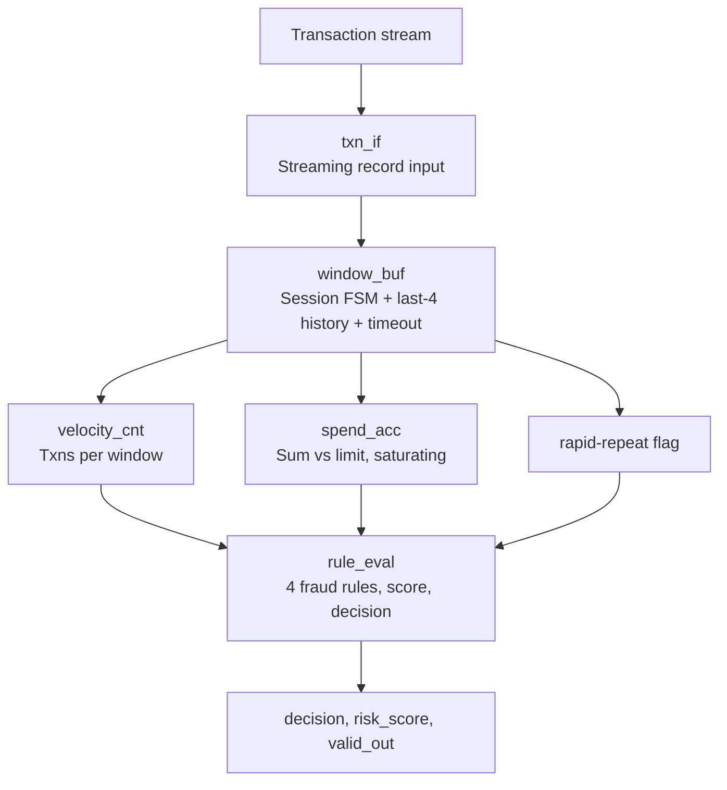

# Real-Time Transaction Risk & Velocity Enforcement Engine for Point-of-Sale Terminals

**Unive Mentorship Program Summer 2026** | Sheikh Sadi | BRAC University

A fully synthesizable Verilog IP that screens point-of-sale transactions for fraud in hardware, using rolling-window velocity and cumulative-spend checks. It is implemented from RTL to GDSII with OpenROAD-flow-scripts on the open **IHP SG13G2 130 nm** PDK.

---

## Project Title
Real-Time Transaction Risk & Velocity Enforcement Engine for Point-of-Sale Terminals

## Project Objective
Design, verify, and physically implement (RTL → GDSII) a fully synthesizable digital IP that performs real-time, rule-based fraud risk screening on a stream of point-of-sale transaction records, computing rolling-window velocity and cumulative-spend checks entirely in hardware, using the OpenROAD flow on IHP SG13G2 130 nm.

## Problem Statement
Point-of-sale and ATM fraud detection is typically handled by backend servers, which adds network latency and a dependence on connectivity. A dedicated local hardware pre-check block can immediately flag suspicious patterns (rapid repeated transactions, spend exceeding a configured limit, abnormal transaction amounts) before or alongside backend authorization. This adds a deterministic, low-power layer of protection suited to embedded or low-cost payment terminals.

## Application Domain
FinTech & Digital Payments

## Project Overview
The IP receives a stream of transaction records (amount, category code, time-delta since the previous transaction), one per cycle, through a valid handshake. A small flip-flop-based rolling window tracks the last few transactions. A velocity counter tracks the number of transactions inside a configurable time window, and a spend accumulator sums amounts inside that window against a programmable limit. A rule-evaluation stage checks for over-limit spend, high velocity, rapid-repeat transactions and amount anomalies, then produces a risk score and a three-way decision (approve / flag for review / decline).

## Block Diagram



## Features
1. Streaming transaction interface, one record per cycle
2. Rolling-window velocity counter and cumulative-spend tracker (flip-flop based, no SRAM)
3. Programmable time window, transaction-count limit, spend limit and anomaly threshold
4. Fixed rule-based risk engine: over-limit, high-velocity, rapid-repeat and amount-anomaly checks
5. Three-way decision output (approve / flag / decline) plus numeric risk score
6. Session reset / timeout handling
7. Fully synchronous, flat RTL, no memory macros
8. Self-checking testbench: normal spending, velocity abuse, over-limit, and edge cases

## Design Specifications

| Parameter | Value |
|---|---|
| Technology | IHP SG13G2 (130 nm), open PDK |
| Language | Verilog HDL (synthesizable) |
| Flow | OpenROAD-flow-scripts (ORFS) |
| Target clock | 20.0 ns period (50 MHz) |
| Transaction input | 16-bit amount, 8-bit category code, 12-bit time-delta, valid strobe |
| Control inputs | reset, window size (12 b), count limit (8 b), spend limit (24 b), anomaly threshold (16 b) |
| Outputs | decision[1:0], risk_score[7:0], valid_out |
| Memory macros | None (registers and combinational logic only) |
| Latency / throughput | 3 cycles latency, one record accepted per cycle |

## Implementation Details

| Module | Role |
|---|---|
| `txn_if.v` | Registers one transaction per cycle when `valid_in` is high |
| `window_buf.v` | Session FSM (IDLE/ACTIVE), elapsed-time tracking, window expiry / timeout, last-4 record history for the rapid-repeat check |
| `velocity_cnt.v` | Saturating transaction counter per window |
| `spend_acc.v` | Saturating 24-bit cumulative spend accumulator per window (never wraps) |
| `rule_eval.v` | Two-stage pipeline: rule flags, then risk score and decision |
| `txn_risk_engine.v` | Top level |

**Fraud rules**

| Rule | Condition | Risk weight |
|---|---|---|
| Over-limit spend | window spend > `spend_limit` | 100 |
| High velocity | window transaction count > `count_limit` | 60 |
| Rapid repeat | time-delta < 8 and same amount and category as one of the last 4 records | 40 |
| Amount anomaly | amount > `anomaly_thr` | 50 |

The risk score is the sum of the triggered weights, saturated at 255.

**Decision:** score < 40 → `00` approve; 40 ≤ score < 100 → `01` flag for review; score ≥ 100 → `11` decline.

**Window behaviour:** elapsed time accumulates each transaction's time-delta. When it exceeds `window_size` (or no session exists), a new window starts, so state is cleared for the first transaction of the next window. The rule evaluator is implemented as a pipelined two-stage block so that a new record can be accepted every cycle.

## Verification
`tb/tb_txn_risk.v` is a self-checking testbench with an independent behavioural reference model. It covers normal spending, velocity abuse, over-limit spend, rapid repeats, amount anomalies, exact-limit and window-expiry edge cases, valid gaps, maximum values and saturation, reset mid-stream, and 4000 random records with varied configurations.

**Result:** 4340 records sent, 4337 checked, 3 flushed by a deliberate mid-stream reset, **0 errors, TEST PASSED.** Verilator lint is clean. Full log: `docs/sim_log.txt`, waveform: `docs/waveform.vcd`.

## Physical Design Results (IHP SG13G2, OpenROAD-flow-scripts)

| Metric | Result |
|---|---|
| Clock | 20.0 ns (50 MHz), ideal port constraint |
| Setup timing | WNS 0.00 ns, TNS 0.00 ns, worst setup slack **13.09 ns** (met) |
| Hold timing | worst hold slack 0.27 ns (met) |
| Clock skew | 0.03 ns |
| Synthesis | 1916 cells, chip area 25,922.56 µm² |
| Final design area (logic, excl. fill) | **29,321 µm²**, 34 % utilization (configured 30 %) |
| Final cell count (excl. fill) | 2186 cells (197 sequential, 1627 multi-input combinational, 66 inverters, 49 clock buffers, 5 clock inverters, 242 timing-repair buffers) |
| Fill cells | 5531 cells, 56,041 µm² |
| Total power | **1.13 mW** (internal 0.930 mW, switching 0.200 mW, leakage 3.64 µW) |
| Power split | sequential 48.6 %, clock 44.1 %, combinational 7.3 % |
| Output | `results/6_final.gds`, `results/*.v` netlist |

All numbers come from `reports/6_finish.rpt`, `reports/synth_stat.txt` and the ORFS logs in this repository.

## Layout Screenshots


## Repository Structure

```
rtl/          Verilog source (6 modules)
tb/           Self-checking testbench
config.mk     ORFS design configuration
constraint.sdc  Timing constraints (20 ns clock)
results/      Final GDSII, netlist, SDC, DEF
reports/      Timing, power, area, synthesis reports
logs/         ORFS stage logs
screenshots/  Physical design screenshots
docs/         Simulation log and waveform, technical report (PDF)
```

## How to Reproduce

```bash
# Simulation
iverilog -g2012 -o sim tb/tb_txn_risk.v rtl/*.v && vvp sim

# Physical design (from OpenROAD-flow-scripts/flow)
mkdir -p designs/src/txn_risk designs/ihp-sg13g2/txn_risk
cp rtl/*.v designs/src/txn_risk/
cp config.mk constraint.sdc designs/ihp-sg13g2/txn_risk/
make DESIGN_CONFIG=./designs/ihp-sg13g2/txn_risk/config.mk
```

## Notes and Limitations
- Timing is reported against an ideal clock port constraint at 50 MHz; there is large slack, so the design could run considerably faster.
- Flow-level checks passed (routing completed; GDS merge reported matching GDS for all LEF cells and no orphan cells). A separate signoff DRC/LVS run was not part of this submission.
- The design assumes a single active session and quasi-static configuration inputs.
